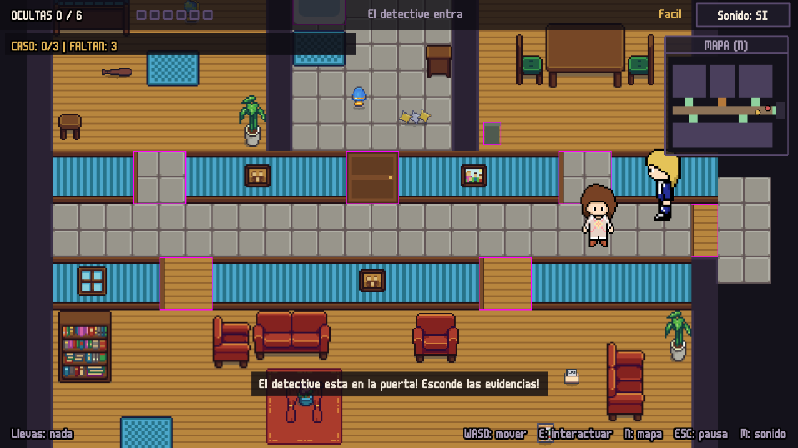
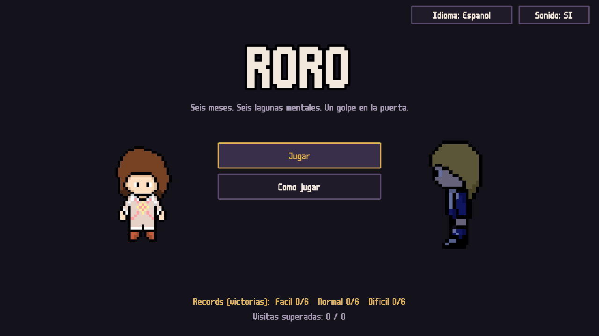
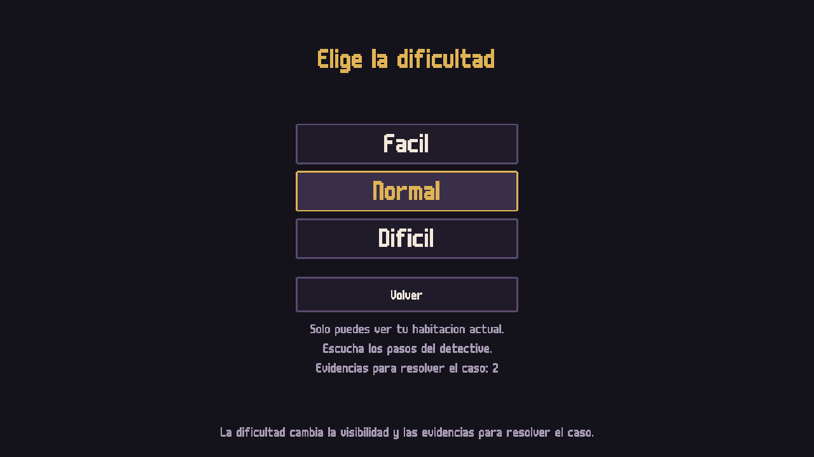
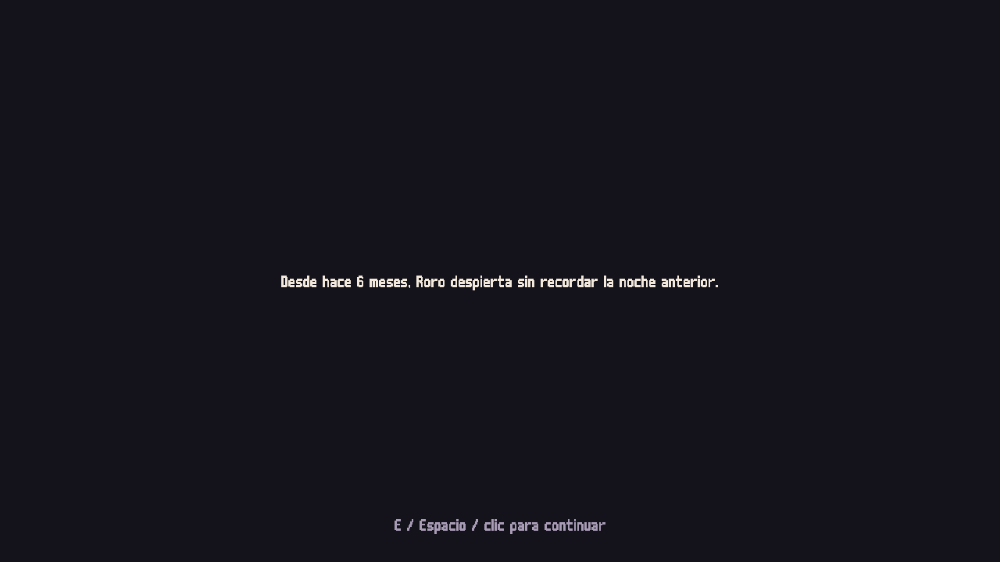
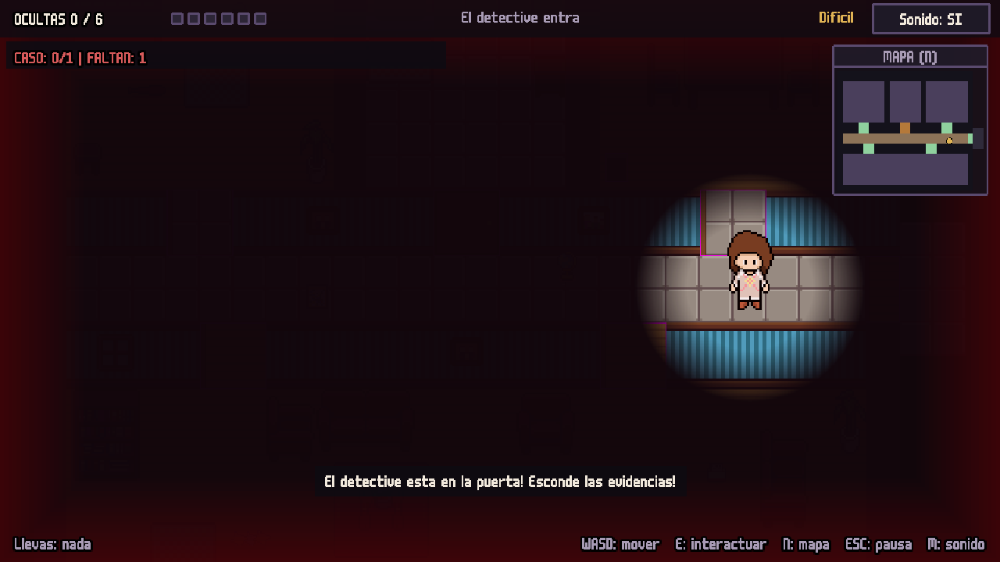
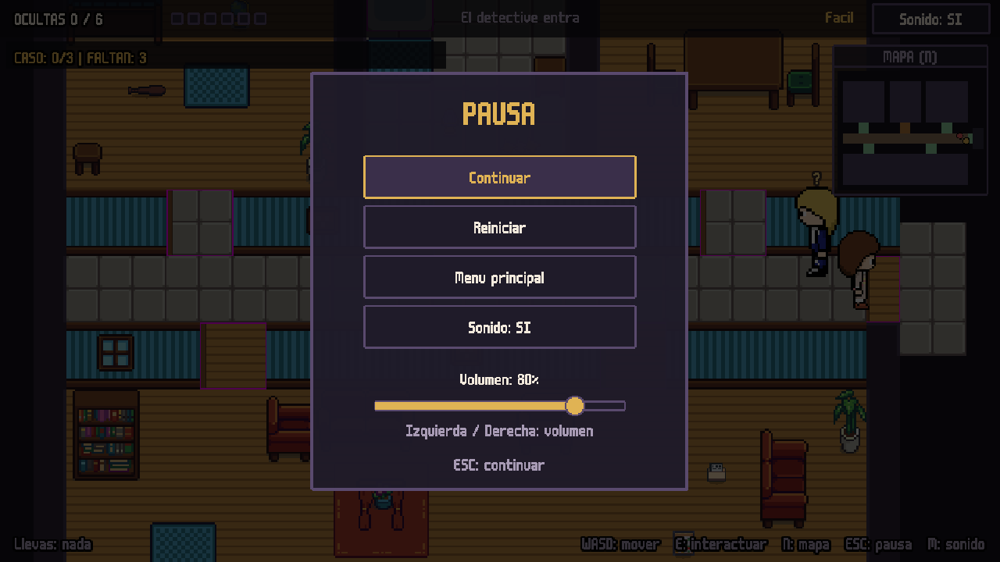
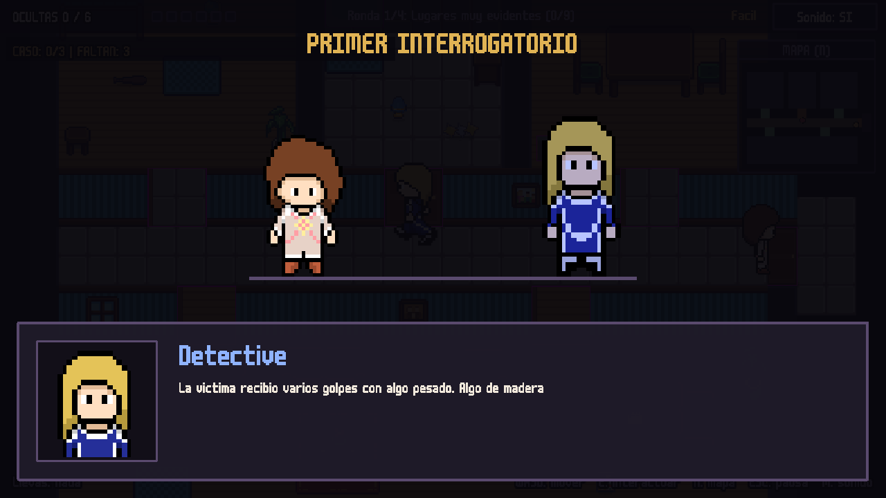
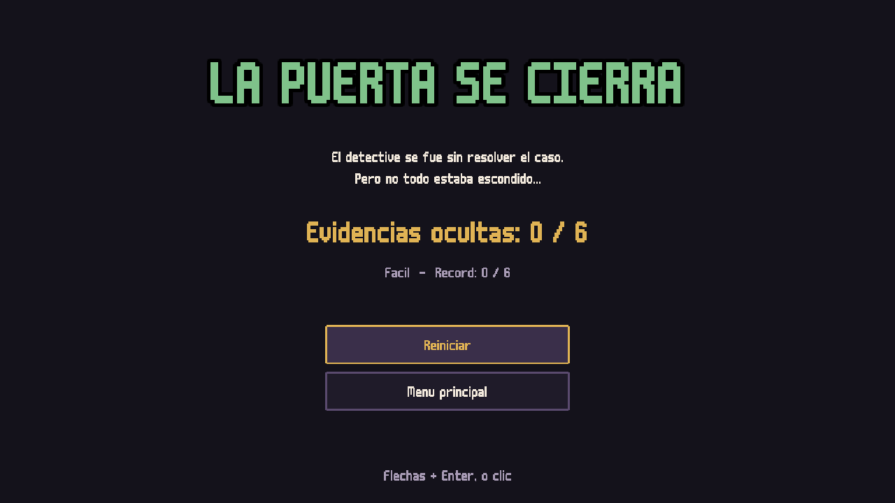
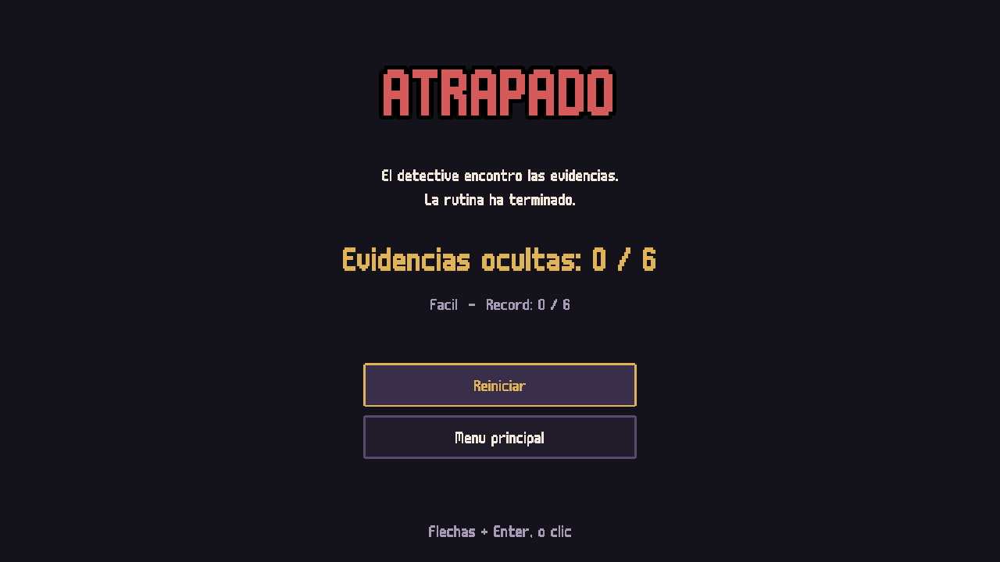
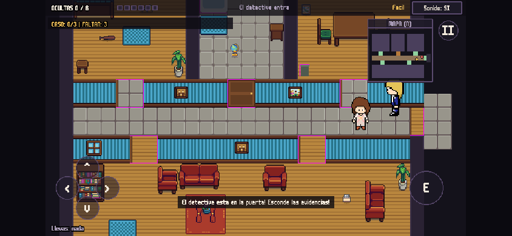

<div align="center">

# R O R O

### *Seis meses. Seis apagones. Un golpe en la puerta.*

**Thriller psicológico · Sigilo · Aventura top-down · Pixel art**

<br>

**https://roro.daxrpm.dev**




> *El detective ya está dentro del apartamento.*
> *Encuentra las pruebas. Escóndelas. No dejes que encuentre suficientes.*

</div>

---

## Índice

1. [Demo y capturas](#-demo-y-capturas)
2. [Acerca del juego](#-acerca-del-juego)
3. [Características](#-características)
4. [Tecnologías utilizadas](#-tecnologías-utilizadas)
5. [Instalación y ejecución](#-instalación-y-ejecución)
6. [Controles](#-controles)
7. [Estructura del proyecto](#-estructura-del-proyecto)
8. [Arquitectura](#-arquitectura)
9. [Cumplimiento de la rúbrica](#-cumplimiento-de-la-rúbrica)
10. [Recursos y créditos](#-recursos-y-créditos)
11. [Equipo de desarrollo](#-equipo-de-desarrollo)
12. [Estado del proyecto](#-estado-del-proyecto)

---

## 🎬 Demo y capturas

| | |
|---|---|
| 🌐 **Versión desplegada** | **<https://roro.daxrpm.dev>** (se juega directamente en el navegador, sin instalar nada) |
| 📦 **Repositorio** | <https://github.com/CelesteLascano017/Roro> |


### Capturas de pantalla

<table>
<tr>
<td align="center" width="33%"><br><sub><b>1 · Menú principal</b><br>Idioma, sonido, récords y progreso guardados</sub></td>
<td align="center" width="33%"><br><sub><b>2 · Selección de dificultad</b><br>Fácil, Normal y Difícil</sub></td>
<td align="center" width="33%"><br><sub><b>3 · Introducción</b><br>Contexto narrativo</sub></td>
</tr>
<tr>
<td align="center"><br><sub><b>4 · Partida (Fácil)</b><br>HUD, pruebas, detective y apartamento visibles</sub></td>
<td align="center"><br><sub><b>5 · Partida (Difícil)</b><br>Visibilidad reducida y borde rojo de presión</sub></td>
<td align="center"><br><sub><b>6 · Pausa</b><br>Reanudar, reiniciar, menú, mute y volumen</sub></td>
</tr>
<tr>
<td align="center"><br><sub><b>7 · Interrogatorio</b><br>Diálogo con retrato y texto progresivo</sub></td>
<td align="center"><br><sub><b>8 · Victoria</b><br>Puntuación, récord y reinicio</sub></td>
<td align="center"><br><sub><b>9 · Derrota</b><br>Game Over con reinicio y menú</sub></td>
</tr>
</table>

### Versión móvil (controles táctiles)

<div align="center">

<br><sub>Cruceta, botón <b>E</b> y botón de pausa equivalentes al teclado.</sub>
</div>

---

##  Acerca del juego

### La historia

Desde hace **seis meses**, Roro despierta cada mañana sin recordar nada de la noche anterior. Cada mes aparece algo nuevo en su apartamento: ropa ensangrentada, objetos que pertenecen a desconocidos, un arma y una nota con un nombre.

Con el tiempo, Roro ha aprendido una rutina: **encontrarlo todo, esconderlo todo y olvidar**.

Pero este es el sexto mes, y esta vez alguien llama a la puerta antes de que la rutina termine. Es la policía. Un detective entra al apartamento para investigar una muerte en el edificio.

### Arquetipo elegido

**Top-Down Adventure / RTS Lite**: movimiento libre, IA con *pathfinding*, recolección de objetos y un enemigo dinámico (el detective) que sigue rondas de inspección.

### El objetivo

Controlas a Roro dentro de su apartamento. Debes **encontrar y esconder seis pruebas** antes de que el detective reúna las suficientes para resolver el caso:

| Prueba | Cantidad | Ubicación inicial |
|---|:---:|---|
| Pertenencias de la víctima (globo terráqueo, adornos de estrellas, lámpara azul, mapa enmarcado) | 4 | Aleatoria, entre puntos válidos predefinidos |
| Bate de béisbol (el arma del crimen) | 1 | Fija, en el dormitorio |
| Nota con el nombre de la víctima | 1 | Fija, en la sala de estar |

Cada prueba escondida suma **1 punto** (máximo **6**).

### Condiciones de victoria y derrota

| Resultado | Condición |
|---|---|
| 🟢 **Victoria** | El detective termina sus cuatro rondas sin reunir las pruebas necesarias para resolver el caso |
| 🔴 **Derrota** | El detective descubre las pruebas necesarias (3 en Fácil, 2 en Normal, 1 en Difícil) y Roro es atrapado |

### Mecánicas principales

- **Llevar y esconder.** Roro solo puede cargar **un objeto a la vez**. Debe llevarlo a uno de los **16 escondites** del apartamento y pulsar `E`. Los objetos escondidos pueden recuperarse y moverse a otro lugar (el punto se resta y se vuelve a sumar).
- **La nota.** Primero se lee: se abre una vista ampliada del papel con el nombre de la víctima y el juego se detiene. Después se puede recoger y esconder.
- **Las rondas del detective.** El detective registra el apartamento en **cuatro rondas**, de lo más evidente a lo más oculto:
  1. Lugares muy obvios, más un vistazo a cada habitación.
  2. Lugares no tan obvios.
  3. Lugares ocultos.
  4. Lugares muy ocultos (ronda más rápida).

  El orden de los puntos se mezcla en cada partida y, tras cada una de las tres primeras rondas, **interroga a Roro**.
- **Cuándo encuentra pruebas.** Cada escondite se registra **una sola vez**: un lugar ya revisado es seguro. Una prueba se descubre si está en el escondite que el detective registra o si está a la vista cerca de él mientras busca. Las pruebas que Roro lleva en las manos nunca se descubren.
- **Presión del caso.** Cada prueba descubierta acerca al detective a la solución. Cuantas menos le faltan, más rápida suena la música y más intenso es el borde rojo de la pantalla.
- **Minimapa.** En la esquina superior derecha muestra el plano del apartamento, la habitación de Roro, las puertas abiertas o cerradas y al detective **solo cuando el juego ya lo muestra** (en Normal y Difícil no revela su posición). No marca pruebas ni escondites. Se pliega con `N` o tocando su barra, y la preferencia se guarda.
- **Distracción.** La tetera de la cocina silba tras unos segundos y atrae al detective. Al terminar de revisarla, vuelve exactamente al punto de su ruta donde lo dejó. Tiene un tiempo de espera de 30 s.
- **Puertas.** Roro puede abrir y cerrar las puertas interiores. El detective abre las que encuentra cerradas en su camino.

### Dificultades

| Modo | Visibilidad | Pruebas para resolver el caso |
|---|---|:---:|
| 🟢 **Fácil** | Todo el apartamento y el detective, en todo momento | 3 |
| 🟡 **Normal** | Solo la habitación donde está Roro (las dos, si está en una puerta) | 2 |
| 🔴 **Difícil** | Solo un pequeño círculo alrededor de Roro | 1 |

En Normal y Difícil el detective deja de verse fuera de la zona visible. Sus **pasos** se escuchan cuando está cerca (hasta unas tres casillas) y su sonido se desplaza a la izquierda o a la derecha según su posición.

---

##  Características

Todas las funcionalidades de esta lista están implementadas en el código actual.

<table>
<tr>
<td valign="top" width="50%">

**🎮 Jugabilidad**
- Movimiento en 8 direcciones con velocidad diagonal normalizada
- Sprites con orientación frontal, trasera y lateral (espejada a la izquierda)
- Sistema de interacción unificado con `E`: siempre actúa sobre el objeto más cercano
- Estados explícitos de cada prueba: *no encontrada*, *cargada*, *escondida* y *descubierta*
- Puntuación derivada de los estados, que no puede contarse dos veces ni superar 6
- Sistema de presión del caso según la dificultad
- Minimapa plegable que respeta las reglas de visibilidad de cada dificultad

</td>
<td valign="top" width="50%">

**🧠 Inteligencia artificial**
- Máquina de estados finitos con 8 estados: *Waiting*, *Entering*, *Inspecting*, *Interviewing*, *Redirected*, *Returning*, *Finished* y *Caught*
- Tabla explícita de transiciones permitidas
- Navegación A* sobre una cuadrícula de casillas transitables, sin atravesar paredes ni muebles
- Recalcula la ruta si se atasca y omite destinos inalcanzables
- Cuatro rutas de inspección con orden aleatorio pero siempre válido

</td>
</tr>
<tr>
<td valign="top">

**🌑 Atmósfera y presentación**
- Apartamento de 5 zonas (dormitorio, baño, cocina, pasillo y sala de estar) construido con el tileset
- Superposición de oscuridad para los modos Normal y Difícil
- Interrogatorios en una pantalla aparte con retrato, nombre y texto que aparece letra por letra
- Música que cambia según la escena y se acelera con la presión del caso
- Efectos de sonido para pasos, puertas, objetos, tetera, menús, victoria y derrota

</td>
<td valign="top">

**⚙️ Sistema**
- Escenas de Phaser para cada estado del juego: menú, dificultad, introducción, partida, diálogo, pausa, victoria y derrota
- Pausa con reanudar, reiniciar, menú principal, silencio y barra de volumen
- Persistencia en `localStorage`: mejores puntuaciones, nivel alcanzado, estadísticas, dificultad, idioma y audio
- Interfaz bilingüe español / inglés, seleccionable desde el menú
- Escalado adaptable a la ventana y controles táctiles en pantalla
- Pruebas automáticas de la lógica, los idiomas y el audio

</td>
</tr>
</table>

---

##  Tecnologías utilizadas

| Tecnología | Versión | Uso en el proyecto |
|---|---|---|
| [**Phaser**](https://phaser.io/) | `3.90.0` | Motor del juego: escenas, renderizado WebGL/Canvas, Arcade Physics, animaciones, cámara, entrada y sonido |
| **JavaScript** | ES Modules | Lenguaje de todo el proyecto (sin TypeScript ni frameworks adicionales) |
| [**Vite**](https://vite.dev/) | `8.3.8` | Servidor de desarrollo y compilación para producción |
| **HTML5 / CSS3** | — | Página contenedora (`index.html`) y estilos de escalado (`src/style.css`) |
| **Node.js** | `^20.19.0` o `>=22.12.0` | Requisito de Vite 8; también ejecuta los scripts de verificación |
| **Web Storage** (`localStorage`) | — | Guardado de puntuaciones, idioma y ajustes de audio |
| **Web Audio API** | — | Reproducción de música y efectos a través de Phaser |

Phaser es la única dependencia de ejecución y Vite la única de desarrollo (ver [`package.json`](package.json)).

---

##  Instalación y ejecución

> ¿Solo quieres probarlo? Entra a **<https://roro.daxrpm.dev>**.

### Requisitos previos

- [**Node.js**](https://nodejs.org/) `20.19` o superior (o `22.12` o superior), con **npm**
- [**Git**](https://git-scm.com/)
- Un navegador moderno con soporte para WebGL o Canvas

### 1. Clonar el repositorio

```bash
git clone https://github.com/CelesteLascano017/Roro.git
cd Roro
```

### 2. Instalar las dependencias

```bash
npm install
```

### 3. Ejecutar en modo desarrollo

```bash
npm run dev
```

Abre la dirección que muestra Vite en la terminal (por defecto, `http://localhost:5173`).

### Otros comandos

| Comando | Descripción |
|---|---|
| `npm run build` | Genera la versión de producción en `dist/` (con rutas relativas, para que funcione desde cualquier carpeta) |
| `npm run preview` | Sirve localmente la versión compilada de `dist/` |
| `npm test` | Ejecuta las pruebas automáticas: lógica del juego, catálogo de idiomas y sistema de audio |
| `npm run check-assets` | Muestra qué recursos declarados existen y cuáles faltan, con sus rutas esperadas |

### Opciones en la URL (desarrollo)

| Parámetro | Efecto |
|---|---|
| `?debug` | Dibuja los cuerpos de colisión de Arcade Physics |
| `?touch` | Fuerza los controles táctiles en un ordenador de escritorio |

---

## 🎮 Controles

### Teclado y ratón

| Tecla | Acción |
|---|---|
| `W` `A` `S` `D` / `↑` `←` `↓` `→` | Mover a Roro |
| `E` | Interactuar: recoger, esconder, recuperar, leer la nota, abrir/cerrar puertas, encender la tetera |
| `Esc` | Pausar y reanudar |
| `N` | Mostrar u ocultar el minimapa |
| `M` | Activar o desactivar el sonido |
| `W` / `S` o `↑` / `↓` | Navegar por los botones de los menús |
| `Enter` / `Espacio` | Confirmar en los menús |
| `E` / `Espacio` / `Enter` / clic | Avanzar en la introducción y en los interrogatorios |
| `←` / `→` | Ajustar el volumen en el menú de pausa |
| Clic | Pulsar botones, cerrar la nota y arrastrar la barra de volumen |

### Controles táctiles

Aparecen automáticamente en dispositivos táctiles, o con `?touch` en la URL.

| Control en pantalla | Acción |
|---|---|
| Cruceta `^` `v` `<` `>` (abajo a la izquierda) | Mover a Roro |
| Botón **E** (abajo a la derecha) | Interactuar |
| Botón **II** (arriba a la derecha) | Pausar |
| Barra **MAPA** (arriba a la derecha) | Mostrar u ocultar el minimapa |
| Toque en botones y en la barra de volumen | Igual que el clic del ratón |

Las instrucciones también son visibles en el juego: la barra inferior de la partida y la opción **Cómo jugar** del menú principal.

---

##  Estructura del proyecto

```text
Roro/
├── index.html                  Página contenedora del juego
├── vite.config.js              Configuración de Vite y plugin que lista los recursos disponibles
├── package.json                Scripts y dependencias
├── docs/                       Diseño, requisitos, reglas, referencias, inventario de recursos y capturas
│   └── screenshots/            Capturas usadas en este README
├── public/assets/              Recursos del juego (se sirven tal cual)
│   ├── characters/             Sprites de Roro y del detective (idle y caminar en 3 direcciones)
│   ├── environment/tilesets/   Tileset de interiores
│   ├── objects/                Pertenencias de la víctima, bate y nota
│   ├── sounds/                 Música (.mp3) y efectos de sonido (.wav)
│   └── ui/fonts/               Fuente pixel m6x11
├── scripts/                    Scripts de Node: pruebas, informe de recursos y generador de efectos
└── src/
    ├── main.js                 Configuración de Phaser y lista de escenas
    ├── style.css               Estilos de la página y escalado pixelado
    ├── data/                   Configuración y contenido, sin lógica
    │   ├── gameConfig.js       Resolución, velocidades, tiempos, dificultades e historia
    │   ├── assetManifest.js    Claves, rutas y procesamiento de cada recurso
    │   ├── apartmentData.js    Habitaciones, puertas, muebles, escondites y puntos de aparición
    │   ├── evidenceData.js     Las seis pruebas, sus estados y el texto de la nota
    │   ├── detectiveRoutes.js  Las cuatro rutas de inspección
    │   ├── dialogueData.js     Introducción e interrogatorios
    │   ├── translations.js     Catálogo de textos en español
    │   ├── animationData.js    Definición de animaciones
    │   └── tilesetData.js      Regiones del tileset
    ├── scenes/                 Una escena de Phaser por pantalla del juego
    ├── world/                  Modelo del apartamento, su renderizado y la proyección del minimapa
    ├── physics/                Colisiones, navegación A* y detección de habitaciones
    ├── ai/                     Máquina de estados del detective
    ├── objects/                Personajes, puertas, pruebas, escondites y distracciones
    ├── managers/               Servicios: recursos, audio, guardado, idioma, pruebas, rutas, interacción, entrada
    ├── ui/                     HUD, minimapa, avisos, nota, diálogos, oscuridad, presión del caso, botones y controles táctiles
    └── utils/                  Procesamiento de imágenes, aleatoriedad, eventos y atmósfera del caso
```

> Los recursos viven en `public/assets/` (en lugar de `src/assets/`) y el audio en `public/assets/sounds/` para que Vite los sirva tal cual y se carguen bajo demanda desde el *loader* de Phaser.

---

##  Arquitectura

El juego separa **datos**, **lógica** y **presentación**. Toda la información editable (el apartamento, las rutas, los textos y los tiempos) vive en `src/data/`, y el resto del código la lee de ahí.

```text
Scene Manager ─▶ Game Objects ─▶ Physics ─▶ UI / HUD ─▶ Audio Manager ─▶ Storage Manager
```

### Flujo de escenas

```text
BootScene ─▶ PreloadScene ─▶ MainMenuScene ─▶ DifficultyScene ─▶ IntroductionScene ─▶ ApartmentScene
                                   ▲                                                    │  ├─▶ PauseScene    (superpuesta)
                                   │                                                    │  └─▶ DialogueScene (interrogatorios)
                                   └──────────── VictoryScene / DefeatScene ◀───────────┘
```

| Escena | Responsabilidad |
|---|---|
| `PreloadScene` | Carga los recursos con barra de progreso, quita el fondo de los sprites recortados y crea las animaciones |
| `MainMenuScene` | Título, instrucciones, idioma, sonido y mejores puntuaciones |
| `ApartmentScene` | Partida: conecta todos los sistemas, pero no contiene las reglas |
| `DialogueScene` | Interrogatorios lineales, sin saltos ni opciones |
| `PauseScene` | Detiene la física, los temporizadores y la IA de la partida |
| `VictoryScene` / `DefeatScene` | Resultado, puntuación, mejor marca y opciones para reiniciar o volver al menú |

### Sistemas principales

| Módulo | Función |
|---|---|
| `world/ApartmentLayout` | Modelo puro del nivel. De él se derivan los gráficos, las colisiones, la navegación y la visibilidad |
| `physics/CollisionManager` | Cuerpos estáticos de Arcade Physics para paredes, muebles y puertas cerradas, independientes de los gráficos |
| `physics/NavigationManager` | Pathfinding A* sin cortar esquinas, con suavizado de rutas |
| `physics/RoomTriggerSystem` | Detecta en qué habitación está cada personaje mediante *overlaps* |
| `ai/DetectiveStateMachine` | Decide **qué** hace el detective. `objects/Detective` decide **cómo** se mueve |
| `managers/EvidenceManager` | Única autoridad sobre los estados de las pruebas, la puntuación y el progreso del caso |
| `managers/InspectionManager` | Construye las rutas y aleatoriza su orden, comprobando que cada punto sea alcanzable |
| `managers/InteractionManager` | Elige el objeto interactivo más cercano y muestra su aviso |
| `managers/AudioManager` | Música, efectos, silencio, volumen y sonido posicional |
| `managers/LanguageManager` | Traducción de textos en tiempo de ejecución |
| `managers/SaveManager` | Persistencia en `localStorage`, tolerante a fallos |
| `managers/AssetManager` | Carga, procesamiento y sustitutos de los recursos que faltan |

### Máquina de estados del detective

```text
WAITING ─▶ ENTERING ─▶ INSPECTING ⇄ INTERVIEWING          (rondas 1-3)
                            │
                            ├─▶ REDIRECTED ─▶ RETURNING ─▶ INSPECTING   (distracción)
                            ├─▶ FINISHED   (ronda 4 terminada: victoria)
                            └─▶ CAUGHT     (caso resuelto: derrota)
```

Las transiciones permitidas están en `DETECTIVE_TRANSITIONS` (`src/ai/DetectiveStateMachine.js`); cualquier otra se rechaza.

> El modelo del nivel, la navegación, las pruebas, las rutas y la máquina de estados no dependen de Phaser. Por eso `npm test` puede verificarlos directamente con Node.

### Rendimiento

- Carga de recursos con barra de progreso y procesamiento único al inicio (no por fotograma).
- Cuerpos de colisión **estáticos** y navegación sobre una cuadrícula precalculada.
- Medido en el navegador de escritorio del autor: **≈140 FPS** (el requisito es ≥ 45 FPS). En una prueba automatizada sin GPU (Chromium *headless* con renderizado por software) se midieron ≈47 FPS, aun así por encima del mínimo.

---

##  Cumplimiento de la rúbrica

### Requisitos técnicos obligatorios

| Requisito | Estado | Dónde |
|---|:---:|---|
| Escenas Phaser, *loader*, menú, pausa, Game Over y reinicio | ✅ | `src/scenes/`, `managers/AssetManager` |
| Sistema de estados | ✅ | `ai/DetectiveStateMachine`, `managers/GameSession`, estados de prueba |
| Estructura modular (`scenes`, `objects`, `ui`, `managers`, `physics`) | ✅ | [Estructura](#-estructura-del-proyecto) |
| Movimiento, colisiones, puntaje y HUD | ✅ | `objects/Roro`, `physics/`, `ui/HUD` |
| Enemigo o reto | ✅ | Detective con IA, rondas e interrogatorios |
| Condiciones de victoria y derrota | ✅ | `VictoryScene`, `DefeatScene` |
| Arcade Physics: colisiones, *triggers*, *overlaps* | ✅ | `CollisionManager`, `RoomTriggerSystem` |
| Música de fondo, ≥ 2 efectos y botón de mute | ✅ | 3 pistas, 12 efectos, tecla `M` y botón en menú, partida y pausa |
| `localStorage`: High Score, nivel alcanzado y audio | ✅ | `managers/SaveManager`, `AudioManager` |
| Escritorio (teclado/ratón) y móvil (táctil) | ✅ | `ui/TouchControls`, escalado `Phaser.Scale.FIT` |
| ≥ 45 FPS y carga eficiente | ✅ | Ver [Rendimiento](#rendimiento) |
| Accesibilidad mínima: contraste, instrucciones, controles, mute | ✅ | Barra de controles en partida, «Cómo jugar», mute |

### Criterios de evaluación

| Criterio (peso) | Evidencia |
|---|---|
| **Funcionalidad principal (20 %)** | Flujo completo de inicio a fin, jugable en <https://roro.daxrpm.dev> |
| **Mecánicas de juego (15 %)** | Recolección, escondites, IA con *pathfinding*, rondas, distracción, puertas y tres dificultades (arquetipo Top-Down Adventure) |
| **Física y colisiones (10 %)** | Arcade Physics con colisiones estáticas, *overlaps* para habitaciones e interacción |
| **Arquitectura y modularidad (15 %)** | Datos / lógica / presentación separados; lógica sin dependencia de Phaser |
| **Rendimiento (10 %)** | ≈140 FPS en escritorio; ver [Rendimiento](#rendimiento) |
| **UX/UI (10 %)** | Menú, dificultad, HUD, pausa, interrogatorios y pantallas de resultado ([capturas](#-demo-y-capturas)) |
| **Audio e inmersión (5 %)** | Música dinámica según la presión del caso, sonido posicional y mute |
| **Responsividad y táctil (5 %)** | Escalado adaptable y controles táctiles equivalentes |
| **Código limpio y documentación (5 %)** | Comentarios explicativos, nombres descriptivos y [`docs/`](docs/) |
| **README, video y presentación (5 %)** | Este documento, [capturas](#-demo-y-capturas) y video demo |

### Bonus implementados

| Bonus | Estado |
|---|:---:|
| IA avanzada (FSM + A* + recálculo de rutas) | ✅ |
| Generación procedural (orden y ubicación aleatoria de rutas y pruebas) | ✅ |
| Shader / efectos visuales (oscuridad, visibilidad circular, filtro rojo de presión) | ✅ (efectos de cámara y superposición, no *shaders* GLSL propios) |
| Minimapa (plano en tiempo real, sin revelar al detective fuera de vista) | ✅ |
| Sistema de inventario (un objeto cargado a la vez) | ✅ (básico) |

### Pruebas automáticas

```bash
npm test
# 199 passed, 0 failed · idiomas OK · audio OK
```

### Documentación de diseño

[`docs/GAME_DESIGN.md`](docs/GAME_DESIGN.md) · [`docs/TECHNICAL_REQUIREMENTS.md`](docs/TECHNICAL_REQUIREMENTS.md) · [`docs/DEVELOPMENT_RULES.md`](docs/DEVELOPMENT_RULES.md) · [`docs/ASSETS.md`](docs/ASSETS.md) · [`docs/REFERENCES.md`](docs/REFERENCES.md)

---

## 🎨 Recursos y créditos

### Gráficos

| Recurso | Autor | Fuente | Licencia |
|---|---|---|---|
| Personajes (Roro y el detective), *32 Free Animated Characters Pack* | Lexlom | [lexlom.itch.io](https://lexlom.itch.io/32-character-pack-pixel-art-4-direction-idle-walking) | CC0, según el autor (consta en `docs/ASSETS.md`) |
| Tileset *Pixel Lands Interiors (demo)* | Trislin | [trislin.itch.io](https://trislin.itch.io/pixel-lands-interiors) | Ver página del autor |
| Pertenencias de la víctima y bate de béisbol | Paquete de objetos de terceros | Ver `docs/ASSETS.md` | Ver `docs/ASSETS.md` |
| Nota y papel de la nota (`victim_note.png`, `name_victim.png`) | Ver `docs/ASSETS.md` | — | Ver `docs/ASSETS.md` |

### Tipografía

| Recurso | Autor | Licencia |
|---|---|---|
| m6x11 (`m6x11.ttf`) | Daniel Linssen | Ver `docs/ASSETS.md` |

### Música

| Archivo | Uso | Fuente y licencia |
|---|---|---|
| `menu_sound.mp3` | Menú principal | Ver `docs/ASSETS.md` |
| `suspenseful.mp3` | Partida (se acelera con la presión del caso) | Ver `docs/ASSETS.md` |
| `rest_sound.mp3` | Dificultad, introducción, pausa, interrogatorios y resultados | Ver `docs/ASSETS.md` |

### Efectos de sonido

Los efectos `.wav` (pasos, golpes en la puerta, puertas, recoger y esconder, papel, tetera, menú, victoria y derrota) son **audio procedural original** creado para este proyecto, sin grabaciones ni muestras externas, según `docs/ASSETS.md`. Pueden regenerarse con:

```bash
node scripts/generate-effects.mjs
```

### Herramientas

[Phaser](https://phaser.io/) · [Vite](https://vite.dev/) · [Node.js](https://nodejs.org/)

---


##  Estado del proyecto

### Implementado

- Flujo completo: menú → dificultad → introducción → partida → interrogatorios → victoria o derrota, con reinicio
- Las seis pruebas, los 16 escondites, las cuatro rutas y los tres interrogatorios
- Tres dificultades, con su visibilidad y presión del caso
- Música, efectos, silencio y volumen persistentes
- Español e inglés
- Controles de teclado, ratón y táctiles
- Despliegue público en <https://roro.daxrpm.dev>

### Limitaciones conocidas

- **Gráficos provisionales.** No existen todavía imágenes para las puertas, los muebles de cocina y baño ni los retratos de diálogo (12 recursos opcionales). El juego dibuja sustitutos con contorno magenta (visibles en las capturas), o reutiliza el sprite del personaje en el caso de los retratos. `npm run check-assets` lista las rutas esperadas.
- La animación de caminar de Roro continúa mientras empuja contra una pared.
- El detective y Roro no colisionan entre sí; es intencionado, para que Roro no pueda bloquear su camino.
- En pantallas verticales de móvil el juego se muestra pequeño, con franjas negras (se recomienda orientación horizontal).
- El equilibrio de la dificultad (tiempos, rango de visión, enfriamiento de la tetera) no se ha ajustado con pruebas de juego de jugadores reales.
- `package.json` declara la licencia `ISC`, pero el repositorio no incluye un archivo `LICENSE`.

### Mejoras futuras

Sustituir los gráficos provisionales, añadir más habitaciones o casos, y un *leaderboard* en línea.

---

</div>
